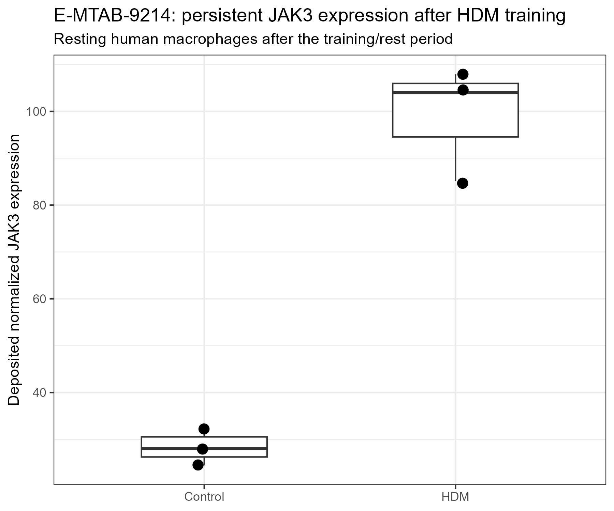

## Study design

E-MTAB-9214 examines persistent transcriptional changes in human monocyte-derived macrophages after house-dust-mite training.

The analysis compares resting macrophages after the training/rest period with matched control macrophages.

## Source analysis

The deposited processed differential-expression table was:

`set2_ctr-VS-D7HDM.txt`

The original contrast orientation was:

`Control vs D7HDM`

Therefore the deposited JAK3 log2 fold-change of -1.700 was reversed for cross-dataset standardization.

The standardized biological contrast used here is:

`D7HDM vs Control`

## JAK3 result

- Standardized log2FC: **+1.700**
- P value: **9.96e-10**
- FDR: **6.44e-07**

## Normalized JAK3 expression

HDM-trained macrophages:

- 107.916
- 85.107
- 104.023

Control macrophages:

- 33.024
- 24.440
- 28.045

Mean expression:

- HDM: **99.016**
- Control: **28.503**

All three HDM-trained samples showed substantially higher JAK3 expression.

## Expression figure

{width=80%}

## Interpretation

JAK3 was strongly and consistently elevated in HDM-trained macrophages after the resting period.

The effect was highly statistically significant after genome-wide multiple-testing correction.

## Final classification

**Strong significant persistent JAK3 upregulation after HDM training.**
