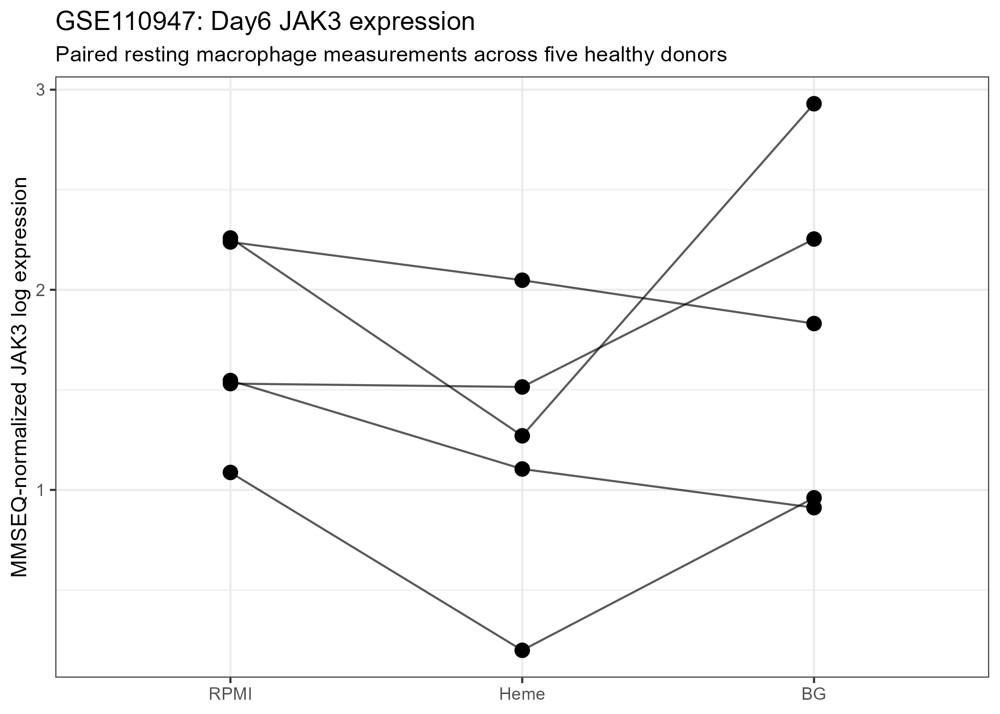
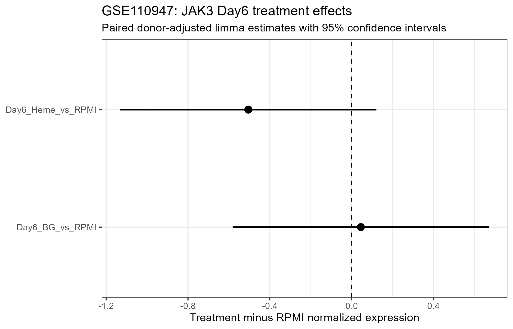

## Study design

Primary human monocytes from five healthy donors were exposed for 24 hours to RPMI, heme, or beta-glucan.

After the initial exposure, cells underwent a five-day differentiation/rest period.

The present analysis uses Day6 resting macrophages before secondary LPS challenge.

## Expression analysis

Deposited MMSEQ gene-level expression files were jointly normalized.

JAK3 Ensembl ID:

`ENSG00000105639`

The paired donor-adjusted model was:

`~ donor + condition`

Genome-wide Benjamini-Hochberg FDR correction was used.

## Heme vs RPMI

- logFC: **-0.505**
- 95% CI: **-1.132 to 0.121**
- P value: **0.101**
- FDR: **0.359**
- Direction: **5/5 donors lower**

The donor-level effect was highly consistent, but the confidence interval crossed zero and the genome-wide FDR was not significant.

**Classification:** consistent negative tendency, but not statistically supported.

## Beta-glucan vs RPMI

- logFC: **0.045**
- 95% CI: **-0.582 to 0.671**
- P value: **0.875**
- FDR: **0.967**
- Direction: **2/5 positive, 3/5 negative**

There was no evidence of persistent JAK3 deregulation after beta-glucan training.

## Paired Day6 expression

{width=90%}

## Effect estimates

{width=90%}

## Overall interpretation

GSE110947 does not provide statistically supported evidence for persistent JAK3 deregulation.

Heme produced a reproducible negative direction across all five donors, whereas beta-glucan produced essentially no average persistent JAK3 effect.

These findings further support stimulus-dependent rather than universal regulation of JAK3 in trained macrophages.

## Final classification

**Heme:** consistent negative tendency, not FDR-supported.

**Beta-glucan:** no evidence of persistent JAK3 deregulation.
