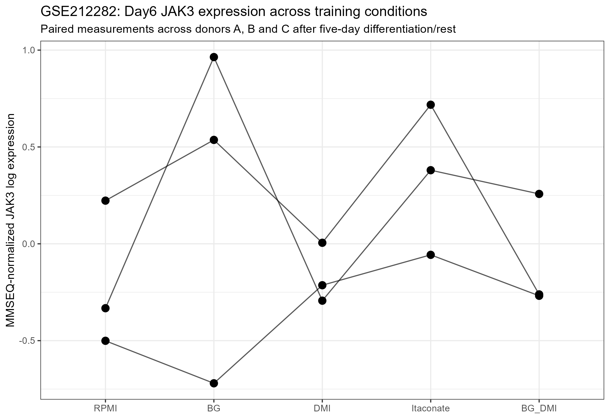
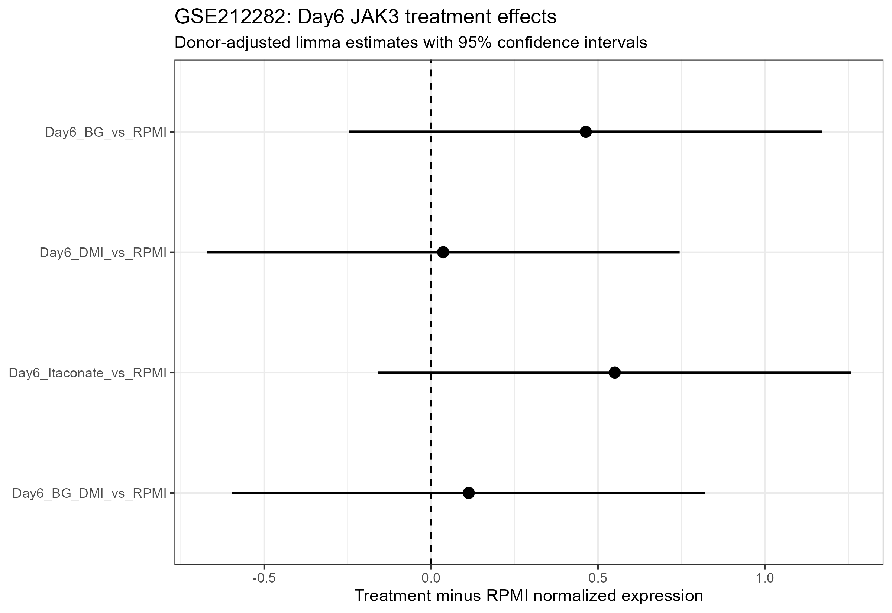

## Study design

GSE212282 profiled primary human monocytes exposed to several trained-immunity conditions.

For the present analysis, Day6 macrophages from donors A, B and C were used after five days of differentiation/rest.

The Day6 conditions were:

- RPMI control
- beta-glucan
- DMI
- itaconate
- beta-glucan + DMI

The primary analysis did not include the later restimulation samples.

## Expression processing

Deposited gene-level MMSEQ expression files were jointly normalized.

JAK3 Ensembl ID:

`ENSG00000105639`

A donor-adjusted model was fitted:

`~ donor + condition`

Genome-wide Benjamini-Hochberg FDR correction was performed separately for each treatment-versus-RPMI comparison.

## JAK3 results

### Beta-glucan vs RPMI

- logFC: **0.464**
- 95% CI: **-0.245 to 1.172**
- P value: **0.172**
- FDR: **0.527**
- Direction: **2/3 donors positive**

Interpretation: positive tendency, but no statistically supported persistent JAK3 deregulation.

### DMI vs RPMI

- logFC: **0.036**
- 95% CI: **-0.673 to 0.745**
- P value: **0.911**
- FDR: **0.997**
- Direction: **2/3 donors positive**

Interpretation: no evidence of persistent JAK3 deregulation.

### Itaconate vs RPMI

- logFC: **0.550**
- 95% CI: **-0.158 to 1.259**
- P value: **0.112**
- FDR: **0.805**
- Direction: **3/3 donors positive**

Interpretation: JAK3 showed a consistent positive tendency across all three donors, but the effect was not statistically supported after genome-wide multiple-testing correction.

### Beta-glucan + DMI vs RPMI

- logFC: **0.113**
- 95% CI: **-0.596 to 0.822**
- P value: **0.726**
- FDR: **0.915**
- Direction: **2/3 donors positive**

Interpretation: no evidence of persistent JAK3 deregulation.

## Paired Day6 expression

{width=90%}

## Effect estimates

{width=90%}

## Overall interpretation

None of the four Day6 treatment comparisons showed statistically supported persistent JAK3 deregulation.

Itaconate produced the most directionally consistent signal, with higher JAK3 expression in all three donors, but the confidence interval included zero and the genome-wide FDR was non-significant.

These results support a model in which persistent JAK3 alteration is context-dependent rather than a universal feature of trained immunity.

## Classification

**No formally supported persistent JAK3 deregulation in GSE212282.**

**Itaconate: consistent positive tendency, requiring independent replication.**
