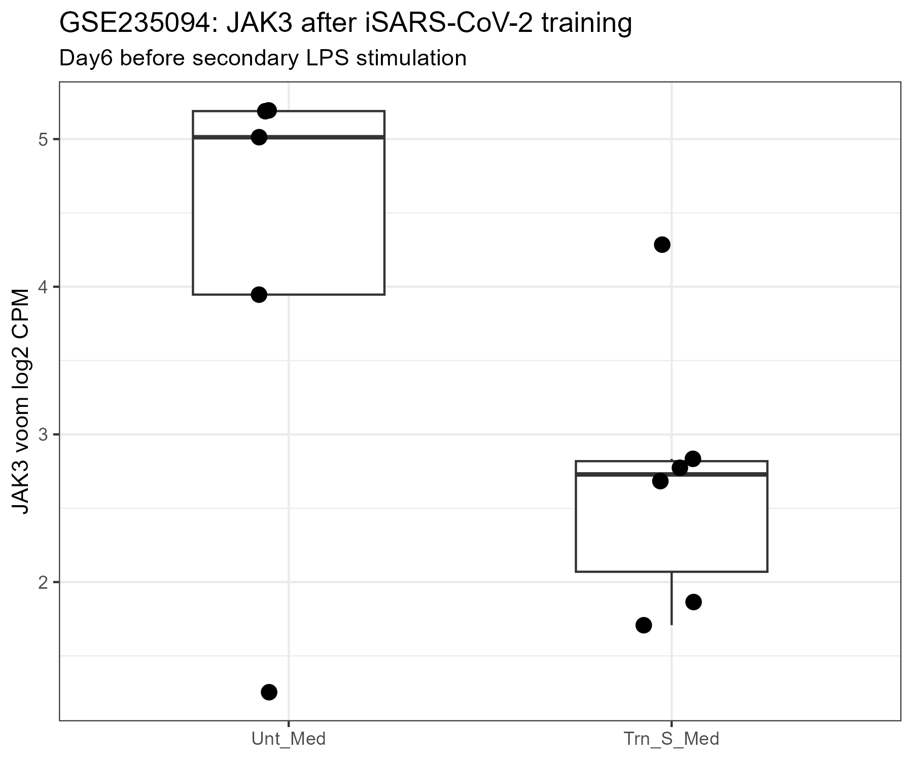

## Study design

Primary human monocytes were exposed to inactivated SARS-CoV-2 for 24 hours, washed, and rested for five days.

The present analysis evaluates the Day6 transcriptome before secondary LPS stimulation.

## Clean primary comparison

The analysis used only samples with unambiguous public metadata.

### Untrained Day6, medium only

- Sample6
- Sample13
- Sample20
- Sample21
- Sample22

### SARS-CoV-2-trained Day6, medium only

- Sample3
- Sample7
- Sample10
- Sample14
- Sample16
- Sample26

Sample5 was excluded because it could not be mapped to a public GEO sample.

Sample8 was excluded because the public metadata were inconsistent regarding LPS restimulation.

## Expression analysis

The deposited gene-level matrix contained fractional estimated counts.

The analysis therefore used:

- TMM normalization
- limma-voom
- empirical Bayes moderation
- Benjamini-Hochberg genome-wide FDR correction

JAK3 Ensembl ID:

`ENSG00000105639`

## JAK3 result

Trained versus untrained Day6:

- logFC: **-1.709**
- 95% CI: **-3.249 to -0.169**
- P value: **0.0324**
- FDR: **0.1436**

## JAK3 expression

Mean voom log2 CPM:

- Untrained: **4.119**
- Trained: **2.691**

Median voom log2 CPM:

- Untrained: **5.012**
- Trained: **2.729**

## Expression figure

{width=80%}

## Interpretation

JAK3 showed a sizeable decrease in the trained Day6 state.

The nominal test was significant and the confidence interval excluded zero. However, JAK3 did not pass genome-wide multiple-testing correction.

Therefore this result should not be described as statistically confirmed persistent JAK3 downregulation.

## Final classification

**Nominal persistent JAK3 downregulation, but not FDR-supported.**

Because this experiment is based on trained monocytes rather than a strict monocyte-to-macrophage endpoint, it is retained as supportive evidence rather than Tier-1 macrophage validation.
