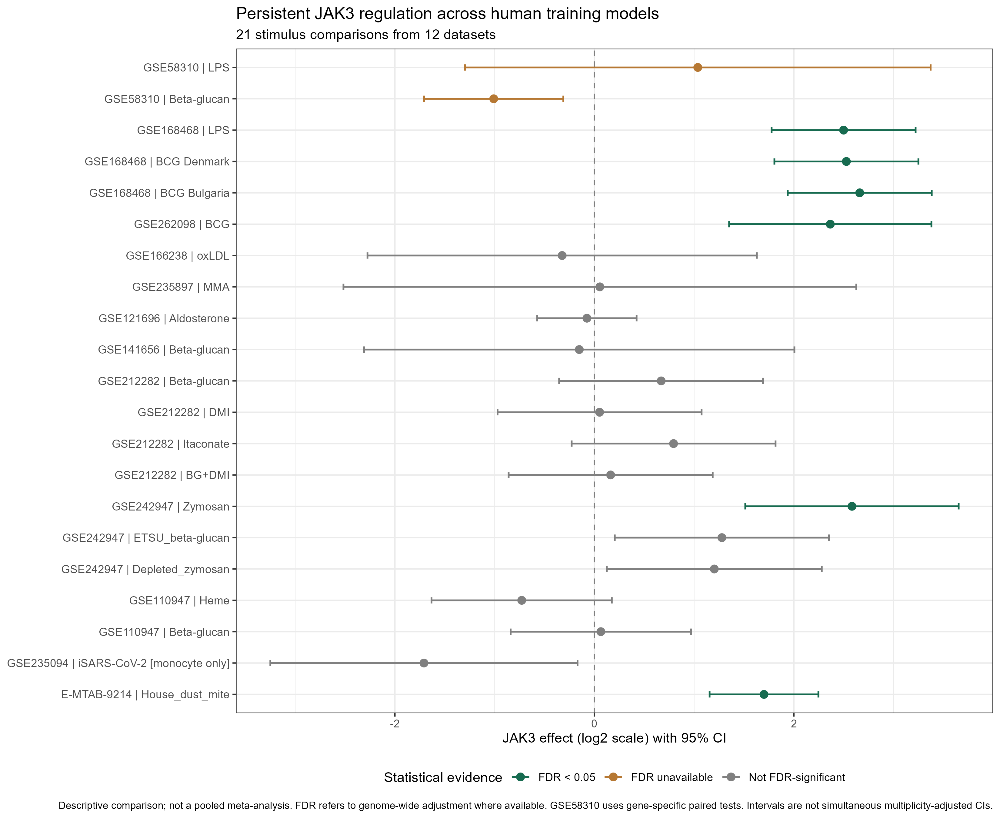
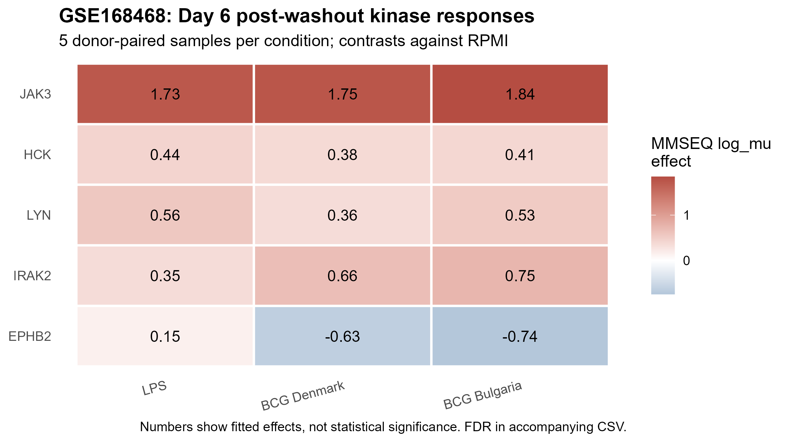

```{r}
root <- "."
master <- read.csv("master_JAK3_summary_harmonized.csv", stringsAsFactors = FALSE)
direct <- read.csv("GSE168468/results/32a_GSE168468_Day6_JAK3_direct_contrasts.csv")
panel <- read.csv("GSE168468/results/32b_GSE168468_five_gene_vs_RPMI.csv")
panel_direct <- read.csv("GSE168468/results/32b_GSE168468_five_gene_direct_contrasts.csv")
stopifnot(nrow(master) == 21, nrow(direct) == 4, nrow(panel) == 15,
          all(is.finite(master$Effect)), all(is.finite(master$CI_low)),
          all(is.finite(master$CI_high)))
show_table <- function(df, caption) knitr::kable(df, digits = 3, caption = caption)
```

## Executive summary

This report consolidates **21 stimulus comparisons from 12 datasets** to assess whether JAK3 expression changes persist after stimulus withdrawal in human monocyte/macrophage systems. **Six comparisons from four datasets** show FDR-supported positive JAK3 regulation. Evidence varies across stimuli and experiments, and these counts do not represent 21 independent studies.

In the donor-adjusted **GSE168468** analysis, resting Day 6 JAK3 is elevated after LPS and both BCG conditions relative to RPMI. Direct BCG-versus-LPS tests do not detect a JAK3 difference, but their confidence intervals do not establish equivalence. A comparison with HCK, LYN, IRAK2 and EPHB2 shows that EPHB2 has FDR-supported BCG-versus-LPS contrasts, whereas JAK3 does not.

## Research questions and methods

The synthesis addresses: (1) reproducibility across training contexts; (2) effect precision; (3) direct stimulus differences; and (4) whether JAK3's pattern is distinctive within a five-gene comparator panel.

Existing coefficients and confidence intervals were harmonized to **log2 units**. MMSEQ natural-log effects were divided by ln(2); DESeq2, RMA-log2, and voom-log2 effects were retained. P values and FDR were not altered by the scale conversion. Confidence intervals refer to individual contrasts; they are **not multiplicity-adjusted simultaneous intervals**. Different source analyses used different designs and uncertainty estimators.

For GSE58310, reported P values come from **gene-specific paired t-tests** and no genome-wide FDR is available. The GSE235094 monocyte-only experiment is supportive but not independent macrophage validation. Multiple conditions within one dataset are not independent replication datasets.

## Where does post-washout JAK3 regulation reproduce?

```{r}
sig <- master[!is.na(master$FDR) & master$FDR < 0.05,
              c("Dataset", "Stimulus", "Effect", "CI_low", "CI_high", "FDR")]
show_table(sig, "JAK3 contrasts with genome-wide FDR < 0.05")
```

Positive FDR-supported effects occur for LPS and BCG in GSE168468, BCG in GSE262098, zymosan in GSE242947, and house dust mite (HDM) in E-MTAB-9214. These six contrasts are from **four datasets**. Other effects are heterogeneous or not statistically supported; nonsignificance is not evidence of no biological effect.

GSE58310 beta-glucan shows a consistent negative JAK3 shift in four donor pairs (paired t-test P = 0.0193), but its Wilcoxon P = 0.1003 and genome-wide FDR is unavailable. This is **nominal**, not FDR-supported, evidence.

### Full evidence table

```{r}
x <- master[, c("Dataset", "Stimulus", "Post_washout_timepoint", "Effect", "CI_low", "CI_high", "FDR")]
names(x) <- c("Dataset", "Stimulus", "Timepoint", "log2 effect", "CI lower", "CI upper", "FDR")
show_table(x, "All 21 harmonized JAK3 contrasts")
```

## How precisely are effects estimated?

{width=100%}

The forest plot displays effects and corresponding 95% CIs on the log2 scale. FDR significance is based on genome-wide adjustment where available. GSE58310 has gene-specific paired-test evidence only. The small sample sizes of some studies and differences in methods constrain generalization.

## Are BCG and LPS effects directly different?

In GSE168468, a donor-adjusted model estimates resting Day 6 effects before secondary challenge.

### Each training condition versus RPMI

```{r}
j <- panel[panel$gene == "JAK3", ]
x <- data.frame(Contrast = j$contrast, log2FC = j$logFC/log(2),
                CI_low = j$CI.L/log(2), CI_high = j$CI.R/log(2), FDR = j$adj.P.Val)
show_table(x, "Day 6 JAK3 training effects versus RPMI")
```

### Direct stimulus comparisons

```{r}
x <- data.frame(Contrast = direct$contrast, log2FC = direct$logFC/log(2),
                CI_low = direct$CI.L/log(2), CI_high = direct$CI.R/log(2), FDR = direct$adj.P.Val)
show_table(x, "Direct BCG/LPS contrasts; converted to log2 units")
```

All three training-versus-RPMI JAK3 contrasts are FDR-supported and positive. None of the direct BCG-versus-LPS JAK3 contrasts is FDR-significant. The result indicates **no difference detected at available precision**, not equivalence.

## Is the JAK3 pattern distinctive?

{width=100%}

### Responses relative to RPMI

```{r}
x <- data.frame(Gene = panel$gene, Contrast = panel$contrast,
                log2FC = panel$logFC/log(2), FDR = panel$adj.P.Val)
show_table(x, "Five-gene training effects versus RPMI")
```

### Direct BCG-versus-LPS responses

```{r}
p <- panel_direct[panel_direct$contrast %in% c("Denmark_vs_LPS", "Bulgaria_vs_LPS"), ]
x <- data.frame(Gene = p$gene, Contrast = p$contrast,
                log2FC = p$logFC/log(2), FDR = p$adj.P.Val)
show_table(x, "Direct contrasts for five comparator genes")
```

JAK3 is upregulated in all three training conditions. IRAK2 also shows FDR-supported positive regulation after BCG, indicating that JAK3 is not the only responsive signaling gene. EPHB2 has **FDR-supported negative BCG-versus-LPS contrasts**, unlike JAK3. This is evidence of different *observed patterns*, not a formal gene-by-gene interaction test.

## Limitations

- Experimental protocols, donors, cell-state definitions and analysis models differ across datasets; differences cannot be attributed to stimulus alone.
- Twenty-one comparisons arise from 12 datasets and are not independent biological replications.
- Some reported intervals are approximate Wald intervals; none is a simultaneous multiple-comparison-adjusted CI.
- GSE58310 has no genome-wide FDR and its nominal negative beta-glucan result requires caution.
- GSE235094 is a monocyte-only supporting model rather than independent resting-macrophage validation.
- The deposited HDM label is D7HDM; its exact days since washout should not be inferred from the label alone.
- This figure is a **descriptive forest plot**, not a pooled effect estimate or meta-analysis.

## Conclusions

**Reproducibility:** Positive post-washout JAK3 regulation has independent support in several models, but is not universal.

**Precision:** The harmonized table reports effect sizes, 95% confidence intervals and genome-wide FDR where available, while retaining study-specific limitations.

**Stimulus dependence:** GSE168468 provides no direct statistical evidence for a JAK3 difference between BCG and LPS at Day 6; this does not prove equivalence.

**Comparator panel:** JAK3 participates in a broader response, while EPHB2 shows direct stimulus-dependent contrasts in this panel. A formal cross-gene test would be needed to compare stimulus sensitivity between genes.

